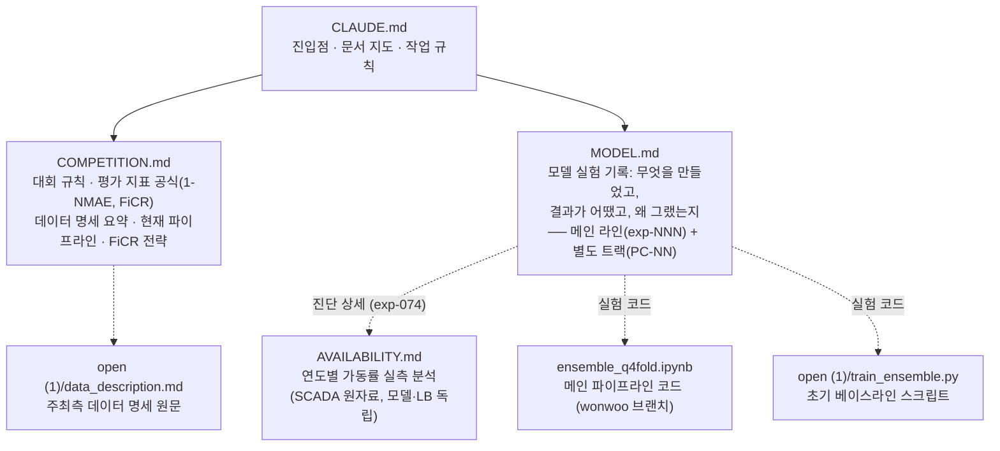

# CLAUDE.md

This file provides guidance to Claude Code (claude.ai/code) when working with code in this repository.

데이콘 "제3회 풍력발전량 예측 AI 경진대회(BARAM 2026)" 참가 프로젝트.

## 문서 구조

## 핵심 사실

- **Score = 0.5×(1-NMAE) + 0.5×FiCR**. 실측 ≥ 설비용량 10%인 시간대만 평가. 공식·전략은 [COMPETITION.md](COMPETITION.md), 정확한 구현은 `ensemble_q4fold.ipynb`의 `metric()`.
- 리더보드에서 1-NMAE는 팀 간 차이가 작고 **FiCR에서 순위가 갈림** → FiCR 개선이 최우선 (1-NMAE도 함께 관리).

## 작업 규칙

- **모델 실험은 [MODEL.md](MODEL.md)에 기록한다.** 결과 수치는 코드 출력·리더보드 사실만 적는다.
- **두 계보를 섞지 않는다.** 챔피언으로 이어지는 작업은 **메인 라인 `exp-NNN`**(판정 = 챔피언 대비 이중 게이트), 챔피언과 다른 파이프라인을 독립적으로 키우는 작업은 **별도 트랙 `PC-NN`**(판정 = 그 트랙의 이전 버전)에 적는다. 새 트랙을 열면 MODEL.md 하단에 `# 별도 트랙 X` 절과 전용 요약표를 만들고, 스크립트도 전용 접두어를 쓴다.
- **별도 트랙이 "챔피언을 넘었다"고 주장하려면 동일 변경을 챔피언에도 적용한 통제를 함께 제시한다** (PC-04에서 통제 누락으로 오판한 사례).
- **MODEL.md의 "원인 분석"은 절대 추측으로 채우지 않는다.** 반드시 사용자와 의논해 합의된 내용만 기록하고, 논의 전이면 `미논의`, 논의해도 원인을 모르면 `모름`이라고 적는다.

## 실행

- 메인 파이프라인: `ensemble_q4fold.ipynb` — Colab 경로 기준이므로 로컬 실행 시 `DATA_DIR`을 `open (1)/`로 변경
- 베이스라인 스크립트: `python "open (1)/train_ensemble.py" [--quick] [--jobs N]`
- 제출 파일은 `utf-8-sig`, `forecast_id`/`forecast_kst_dtm` 변경 금지, 예측값은 `[0, 설비용량]`으로 clip

## 주의

- 예보 데이터는 전날 13:00 이후 사용 가능(`data_available_kst_dtm`) → 발전량 lag 피처는 리크
- 그룹3은 라벨이 2023년부터만 존재 (1년 적음)
- 이 폴더는 git repo가 아님. 팀 repo `26-BITAmin/Dacon_WindPower`(wonwoo 브랜치)의 로컬 클론은 `D:\projects\Dacon_WindPower` — 커밋 시 코드(exp*.py)·문서(MODEL.md 등)만 복사해 푸시 (로그·CSV·parquet 미추적 관례)
