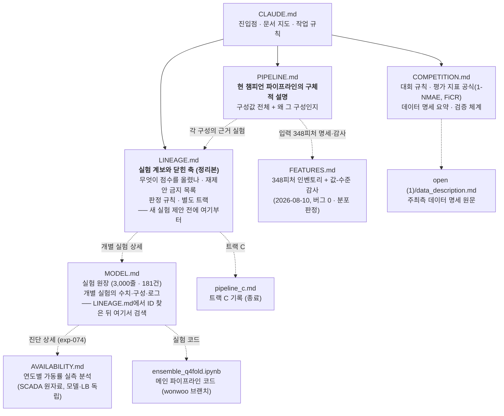

# CLAUDE.md

This file provides guidance to Claude Code (claude.ai/code) when working with code in this repository.

데이콘 "제3회 풍력발전량 예측 AI 경진대회(BARAM 2026)" 참가 프로젝트.

## 문서 구조

## 핵심 사실

- **Score = 0.5×(1-NMAE) + 0.5×FiCR**. 실측 ≥ 설비용량 10%인 시간대만 평가. 공식·데이터 명세·검증 체계는 [COMPETITION.md](COMPETITION.md), 정확한 구현은 `ensemble_q4fold.ipynb`의 `metric()`. (COMPETITION.md 5절 "FiCR 개선 전략"은 **초기 가설 5개가 전부 기각된 종료 기록**이지 할 일 목록이 아니다.)
- 리더보드에서 1-NMAE는 팀 간 차이가 작고 **FiCR에서 순위가 갈림** → FiCR 개선이 최우선 (1-NMAE도 함께 관리).
- **★ 현 챔피언 = `v_pdtrk_anwshub_optlgb_submit.csv` (LB public 0.6553807, 2026-08-12, PD-16 — 트랙 D).** 구조 = 잔차형 직렬: DL 커브 base(AnEn K30 멤버 ws 30열 → MTMLP 384×3·huber·ES·3시드) + 잔차 GBM(optlgb 단독 = Optuna best 633트리·잎36·min_child141, 입력 = GBM 풀 269+DL 출력) + 챔피언 PP(편향맵→rolling α0.40→clip 0.16→스케일 .98/.98/.97, 스냅 OFF). 빌더 `open (1)/testing/curve_track/pd16_submit_optlgb.py` (DL 캐시 = pd10_*). 구 챔피언 대비 +0.00175(2.9σ), **이득 전부 FiCR(+0.0042)**. 트랙 기록은 MODEL.md `# 별도 트랙 D`.
- **이전 챔피언(메인 라인) = `v_a40nosnap_ens3es_dles_w65_g3s97_submit.csv` (LB 0.6536314, 2026-08-07, exp-137).** GBM·DL 양 멤버 모두 early stopping판 — val 블록(2024년 3/6/9/12월 11~20일) 학습 제외 + 자기 손실 감시(DL은 q60·patience 15, GBM은 가중 MAE·patience 56/73)·best 복원. 빌더 `open (1)/testing/wind_input/wi16_submit_gbmes.py`(GBM) + `wi10_submit_es.py`(DL). 파이프라인 명세는 [PIPELINE.md](PIPELINE.md) (메인 라인 기준 — 트랙 D 미반영).
  - **구조 변경 계열 3승 1패**: 스냅 제거 +0.0019(exp-126) → DL ES +0.0015(exp-132) → GBM ES +0.0003(exp-137, 1σ 미만) → **val 블록 재배치 −0.0035(exp-143)**. 3승은 전부 FiCR 단독 이득·게이트 불가측이었고, 한 번의 패배가 3승 합계와 맞먹는다. 스케일 0.98은 ES 챔피언에서도 유효(exp-136 통제, 제거 시 −0.0033 균등 손실 = 2025 레벨 보정).
  - **DL 입력 축은 LB 9전 9패로 종결**(exp-142 full_b5 −0.0052가 최대 손실, 사용자 "BIV 포기" 선언). 게이트 12σ도·ES판도·Δn≈0 프로파일도·2023 세트 +0.0064도 전부 역전.
  - ⚠ **계기를 새로 만드는 접근은 2회 연속 실패했다 — 재시도 금지.** ① Δn 무지불 판별(exp-134 소급 5쌍 완벽) → 첫 전향 적용에서 즉시 기각(exp-135). ② 비교 세트(exp-139·140 소급 4/7) → **전향 2건 모두 부호 반대**(exp-142·143). 게이트 ΔScore·Δf는 LB와 역상관(exp-134, 6쌍 −0.90)이고, **어떤 사전 지표도 FiCR 하방을 막지 못했다**.
  - ⚠ **제출 CSV를 보존할 것.** dles·gbm_es의 best-epoch/iter는 시드·val 구성 의존이라 재현성 미확인 (캐시 `wi16_gbm_es_g*.parquet`·`wi10_test_dl_es_d5.parquet`도 보존).
  - ⚠ **제출 CSV를 보존할 것.** 트랙 성분이 선 `pcden` 커브는 **재현 불가능한 무작위 draw**임이 확정됐다(PC-28~31). 혼합을 다시 쓰려면 기존 트랙 CSV가 필요하고, 커브 계열을 재학습해도 복원되지 않는다. 스냅 제거판 재혼합 `v_mix70_nosnap_pctrk_submit.csv`는 빌드만 돼 있고 미제출.
- **★ 새 실험을 제안하기 전에 [LINEAGE.md](LINEAGE.md)를 먼저 읽을 것.** MODEL.md의 정리본으로, ① 챔피언 계보 트리 ② 무엇이 실제로 점수를 올렸나(상위 4개가 전체 상승의 66%, 전부 입력 추가·역할 분담) ③ **재제안 금지 축 목록** ④ 판정 규칙 ⑤ 별도 트랙 현황이 들어 있다. 개별 실험의 수치·구성·로그가 필요하면 거기서 ID를 찾아 [MODEL.md](MODEL.md)에서 검색한다 — **MODEL.md는 원장이므로 통독하지 말 것.**
- **★ 채택 규칙 (2026-08-08 사용자 결정)**: ① 2024 게이트(제출 작동점) **Δn ≥ −0.0005** — 하한선으로만 쓴다 ② **Δf·ΔScore·홀드아웃·비교세트는 보지 않는다**(Δf는 역상관이라 조건에 넣으면 역효과) ③ 통과분 중 채택은 **구조 논리**로 — **① 적합 자유도 축소 3승 0패 / ② 정보·보정 제거 0승 2패 / ③ 다른 것으로 교체 0승 다패**. 범주 ①의 미실시 잔여는 **후처리 평활 α 재검 하나**(사용자 지시로 최후순위).
- **판정에 쓸 노이즈 상수**: LB 1σ ≈ **0.0006**(exp-090) · 커브 채널 CV 1σ ≈ **0.0003**(PC-30) · **격자 셀 순위 반분 신뢰도 0.05**(exp-141 — 격자 최댓값을 신호로 읽지 말 것, 축 주변화로만 판독). 갱신폭이 이보다 작으면 신호로 읽지 말 것.

## 작업 규칙

- **모델 실험은 [MODEL.md](MODEL.md)에 기록한다.** 결과 수치는 코드 출력·리더보드 사실만 적는다.
- **두 계보를 섞지 않는다.** 챔피언으로 이어지는 작업은 **메인 라인 `exp-NNN`**(판정 = 챔피언 대비 이중 게이트), 챔피언과 다른 파이프라인을 독립적으로 키우는 작업은 **별도 트랙 `PC-NN`**(판정 = 그 트랙의 이전 버전)에 적는다. 새 트랙을 열면 MODEL.md 하단에 `# 별도 트랙 X` 절과 전용 요약표를 만들고, 스크립트도 전용 접두어를 쓴다.
- **별도 트랙이 "챔피언을 넘었다"고 주장하려면 동일 변경을 챔피언에도 적용한 통제를 함께 제시한다** (PC-04에서 통제 누락으로 오판한 사례).
- **MODEL.md의 "원인 분석"은 절대 추측으로 채우지 않는다.** 반드시 사용자와 의논해 합의된 내용만 기록하고, 논의 전이면 `미논의`, 논의해도 원인을 모르면 `모름`이라고 적는다.

## 실행

- 메인 파이프라인: `ensemble_q4fold.ipynb` — Colab 경로 기준이므로 로컬 실행 시 `DATA_DIR`을 `open (1)/`로 변경
- 베이스라인 스크립트: `python "open (1)/train_ensemble.py" [--quick] [--jobs N]`
- 제출 파일은 `utf-8-sig`, `forecast_id`/`forecast_kst_dtm` 변경 금지, 예측값은 `[0, 설비용량]`으로 clip

## 주의

- 예보 데이터는 전날 13:00 이후 사용 가능(`data_available_kst_dtm`) → 발전량 lag 피처는 리크
- 그룹3은 라벨이 2023년부터만 존재 (1년 적음)
- 이 폴더는 git repo가 아님. 팀 repo `26-BITAmin/Dacon_WindPower`(wonwoo 브랜치)의 로컬 클론은 `D:\projects\Dacon_WindPower` — 커밋 시 코드(exp*.py)·문서(MODEL.md 등)만 복사해 푸시 (로그·CSV·parquet 미추적 관례)
